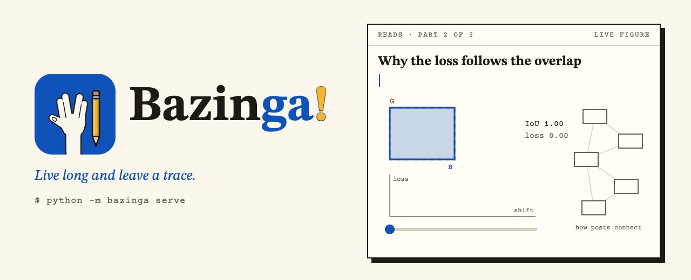

<p align="center">
  <picture>
    <source media="(prefers-color-scheme: dark)" srcset="documentation/assets/brand/banner-dark.gif">
    
  </picture>
</p>

# Bazinga

A template for a personal site and technical blog. You write posts in Markdown. Equations render properly,
diagrams are drawn from a few lines of text, and figures have sliders readers can move. The whole site also works as
a wiki that readers can ask questions.

You need Python 3.11 or newer. There is no Node and no bundler.

## 1. Start

```bash
git clone https://github.com/<you>/<your-site>.git && cd <your-site>    # or GitHub: "Use this template"
python3 -m venv .venv && .venv/bin/pip install -r requirements.txt
.venv/bin/python -m bazinga serve
```

Open http://127.0.0.1:8000. You see the example site, and it rebuilds whenever you save a file.

## 2. Make it yours

1. **`site.yml`:** your name, address, links, and the home page (about, experience, education, contact). Every field
   has a comment.
2. **`content/cv.yml`:** the CV page. Put your photo at `static/images/photo.svg` (or point `site.yml` at a .jpg).
3. **`content/`:** delete the example posts and write your own. Keep the four guides in `content/reads/` until you
   no longer need them.
4. **`content/LICENSE.md`:** the licence for your writing.

## 3. Write a post

There are two ways, and both edit the same file:

- **In the Editor.** While `serve` is running, every page has a **Write** button (and **Edit this page**). The
  Editor is a writing window with a live preview, with helpers for equations, diagrams, figures and citations.
- **In any editor.** Create `content/reads/my-post.md`, and the open page reloads when you save.

A post looks like this:

```markdown
---
title: "Attention, Step by Step"
date: 2026-10-20
status: draft            # draft or published
summary: "Two or three sentences for lists, search and the map."
topics: [attention, transformers]
---

Attention turns similarities into weights [@Vaswani17]. See also [[read:softmax-and-temperature]].

$$
\operatorname{softmax}(z)_i = \frac{e^{z_i}}{\sum_j e^{z_j}}
$$
```

| You write | You get |
|---|---|
| `$x^2$` and `$$ … $$` | an equation in a sentence, or one on its own line |
| `$$ … $$ {#eq:name}` and then `[eq:name]` | a numbered equation, and a reference to it |
| `[[read:slug]]` | a link to another post, which also adds a line on the map |
| `[@Key]` | a numbered citation. `python -m bazinga cite 1706.03762` adds a paper by its arXiv id or DOI |
| a ```` ```diagram ```` block | a diagram (see 5) |
| `::figure name` | an interactive figure (see 6) |
| `> [!NOTE]`, `> [!TIP]`, `> [!WARNING]`, `> [!KEY]` | a coloured box |
| tables, footnotes, code, images | what Markdown normally gives you |

`content/reads/welcome.md` shows every feature next to the text that makes it.

## 4. Equations

You write ordinary LaTeX between `$ … $` or `$$ … $$`. It is turned into real math when the site is built, so
readers' browsers load no math library. If a formula would not render, the build stops. It names the line and gives
the fix, for example: `\begin{align} is not supported here; write \begin{aligned} … \end{aligned} inside $$ … $$`.

- In the Editor, **Equation…** opens a helper with a palette and a live preview. It can also insert a ready-made
  equation (a fraction, a sum, a matrix, cases).
- From a terminal, `python -m bazinga math "\frac{a}{b}"` checks a single formula.
- `content/reads/writing-math.md` is the full guide.

## 5. Diagrams: no code needed

To draw a diagram, write the boxes and arrows as text in the post:

````markdown
```diagram
Image -> Patches -> Encoder [accent] -> Class [emphasis]
Encoder -.-> Attention map: "optional"
caption: "How the model reads an image."
```
````

When the site is built, the boxes are laid out, the arrows are routed around them, and the diagram is drawn in the
site's colours. It also gets a narrower layout for phones. Nothing runs in the reader's browser.

| Write | For |
|---|---|
| `A -> B`, `A <-> B`, `A -.-> B`, `A ==> B`, `A -- B` | an arrow, a two-way arrow, a dashed arrow, a thick arrow, or a plain line |
| `A -> B: "label"` | a label on the arrow |
| `(Start)`, `{Valid?}`, `[/Data/]`, `((Join))` | a rounded box, a diamond, a cylinder, or a circle |
| `[accent]`, `[emphasis]`, `[muted]`, `[data]` | a highlight, the result, a side detail, or data |
| `group Name { A -> B }` | a frame around some boxes |
| `direction: down` | top to bottom instead of left to right |
| `timeline` and `tree` blocks | a timeline or a tree |

In the Editor, type `/` and choose **Diagram…**, and the drawing appears next to your text. The full guide, with
flowcharts, timelines and trees, is `content/reads/drawing-diagrams.md`.

*Optional, with code:* if the boxes come from data or a loop, write a small function in `drawings/` and place it with
`::drawing module.function | caption`. The Editor has six starters (**Drawing from code…**).

## 6. Interactive figures: no code needed either

A figure is a picture with sliders under it. When the reader moves a slider, the picture redraws in their browser.
It also shows straight away without any script, because the build draws it first.

**Without code:** in the Editor, choose **Figure… → New figure → Fill in a form**. Pick a kind and type formulas as
you would on paper:

- a function plot, such as `y = a*sin(f*x)*exp(-d*x)`;
- shapes and curves;
- bars;
- a heatmap;
- a distribution;
- a pasted data table;
- a 3-D scene: points, segments, boxes and a surface `z = f(x, y)`, which readers turn by dragging.

The sliders, readouts and presets are fields of the form, and the preview redraws as you type. Saving writes
`figures/<name>.py`. Then put `::figure <name>` in the post.

**From a template**, when you want more than a form gives: copy the one closest to what you want and change its
words and numbers. Every line of each template has a comment.

| Template | What it is |
|---|---|
| `slider_plot` | a curve with sliders, a reference line and readouts |
| `data_lines` | your own table of numbers as lines (paste over the example data) |
| `scatter_fit` | random points and the line that fits them |
| `distribution` | a bell curve with a shaded band |
| `linked_panels` | two panels moved by one control |
| `compare_bars`, `heatmap` | bars side by side, and a labelled grid |
| `animation`, `sampling`, `vector_field` | animations with a Play button: a thrown ball, a die rolled again and again, a path through a field of arrows |
| `step_through` | an algorithm, one step at a time |
| `geometry2d`, `matrix_transform` | shapes and a matrix moving the plane |
| `scene_basic`, `surface_plot` | 3-D: a cube with numbered axes, and a surface z = f(x, y) with sliders |
| `vectors_planes`, `camera_rig` | 3-D with points to drag: two vectors and their cross product, and a pinhole camera with its picture and a panel to move it |

```bash
python -m bazinga figure starters                           # list them
python -m bazinga figure new my_plot --from data_lines      # copy one to figures/my_plot.py
python -m bazinga figure test my_plot                       # runs it at every setting; fails on errors or if slow
```

In the Editor it's **Figure… → New figure → Start from an example**. The page `content/reads/templates.md`
(`/reads/templates/` on the example site) shows every template working. It also has text diagrams ready to copy.

A figure file lists its sliders and has one function that returns what to draw:

```python
TITLE = "Softmax temperature"
CONTROLS = [{"name": "t", "kind": "slider", "label": "temperature", "min": 0.1, "max": 5, "step": 0.1, "value": 1}]

def compute(t=1.0, _narrow=0):
    import math
    z = [3.0, 2.2, 1.6, 1.1, 0.4]
    e = [math.exp(v / t) for v in z]
    return {"panels": [{"kind": "bars", "bars": [{"label": f"class {i+1}", "value": v / sum(e)}
                                                 for i, v in enumerate(e)]}]}
```

**In 3-D**, a figure builds a scene with `bazinga/scene3d.py` (standard library only, shipped next to the renderer
and imported the same way at build time and in the browser). Readers turn it by dragging the picture and move
points by dragging their handles:

```python
from bazinga.scene3d import Scene

CONTROLS = [{"name": "view", "kind": "orbit", "value": [35, 25]}]    # no slider: drag the picture

def compute(view=(35, 25), _narrow=0):
    sc = Scene()                                     # z is up; Scene(up="-y") for the camera convention
    sc.axes3d(lo=(-1, -1, -1), hi=(1, 1, 1))
    sc.surface(lambda x, y: x * x - y * y, x=(-1, 1), y=(-1, 1), z_range=(-1, 1))
    sc.vector((0, 0, 0), (0.8, 0.3, 0.6), label="v")
    return sc.render(view=view, narrow=_narrow, dist=5)
```

A scene also has points, lines, boxes, planes, curves, labels, measurements, cameras with the picture they take,
and handles: a `pad` (shown) or `hidden` control that a handle drives, a `_drag` argument for `compute()`, and
`apply_drag()` to turn the drag into values. `figure test` drags every handle too.

`content/reads/making-figures.md` is the full guide.

## 7. Publish

In the Editor, **Publish** checks the post, builds the site, updates the wiki files, commits the post and pushes it.
Your host then deploys it. **Schedule** publishes on a later date, and **Unpublish** turns a post back into a draft.
From a terminal: `python -m bazinga publish -- content/reads/my-post.md`.

Publishing works only on your own computer. The Editor listens on `127.0.0.1` and needs a new key each time it starts.
None of it is part of the built site, so the live site cannot change anything.

To check everything without publishing, run `python -m bazinga check`.

## 8. The wiki, the map and Ask

Every build also writes these, without any setup:

- `/explore/`, a map of how your posts connect;
- topic pages and series pages;
- `wiki/index.md` and `wiki/log.md`;
- `llms.txt`;
- the passages behind **Ask**.

Readers ask a question on any page and get an answer from your own pages, worked out in their browser.

A language model is optional. To use one, set `llm:` in `site.yml` and put the key in `.env.local`, which is never
committed. Any OpenAI-compatible service works, including a local one through Ollama. You then get two extras:

- **Ask** can also give a written answer, through `api/ask.py` on Vercel.
- `python -m bazinga wiki ingest|lint|highlights` suggests links, topics and summaries. The suggestions are written
  to `proposals/` for you to accept or reject, and never go straight onto the site.

## 9. Deploy

`site.origin` in `site.yml` is the address the site lives at; canonical links, the sitemap and the feed use it, and a
path in it (`https://you.github.io/notes`) puts every link under `/notes`. `python -m bazinga serve` always serves at
the root of 127.0.0.1.

| Host | What to set |
|---|---|
| Vercel | Import the repository (`vercel.json` runs the tests and the build). Set `site.origin` to your domain. For written answers on Ask, set `llm.model` and add `LLM_API_KEY` (and optionally `SITE_URL`, the site's address) in Project → Settings → Environment Variables. |
| Netlify | Import the repository (`netlify.toml`). Set `site.origin`. |
| GitHub Pages | Settings → Pages → Source: GitHub Actions. The workflow (`.github/workflows/pages.yml`) fills in the address, including the `/<repo>/` path. |
| Custom domain | Set `site.origin` to it (on GitHub Pages the workflow picks the domain up by itself). |
| Anywhere | `python -m bazinga build` (or `--origin https://…` for another address), then upload `_site/`. |

## Folders

```
site.yml      settings and home page        content/   your posts, cv.yml, topics.yml, references.yml
figures/      interactive figures           drawings/  diagrams made with code (optional)
static/       images and files              wiki/      generated wiki files
bazinga/      the engine, theme and Editor  tests/     run before every deploy
```

The full design is in `docs/DESIGN.md`. To change the theme, copy a file from `bazinga/theme/` to the same path under
`theme/` and edit it there.

## Licence

The code is under the [MIT licence](LICENSE). The example content is under [CC BY 4.0](content/LICENSE.md). Replace
it with your own. Third-party components are listed in [THIRD_PARTY.md](THIRD_PARTY.md).
