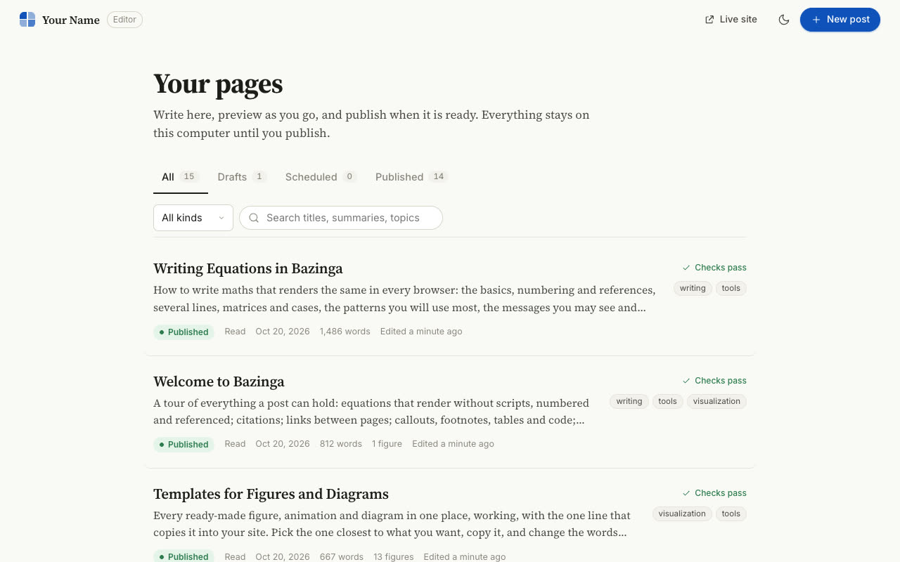

# The Editor

The Editor is Bazinga's writing window. It is a list of your pages, a Markdown pane with a live preview of the real
page, helpers for equations, figures, diagrams and citations, the checks, saved versions, and a Publish button. On
this page you will open it, write in it, and publish from it with a dry run first.

It only ever runs on your own computer. Nothing of it is copied into the built site, so the live site cannot be
changed through it.

## Open it

There are two ways. Both open the same Editor.

=== "From serve (most of the time)"

    ```bash
    python -m bazinga serve
    ```

    The Editor starts with the site, on the serve port + 1:

    ```text
      The Editor runs at http://127.0.0.1:8001/ (the Write button opens it)
    ```

    Open <http://127.0.0.1:8000>, then press **Write** in the rail (or **Edit this page** on a post).

=== "On its own"

    ```bash
    python -m bazinga editor
    ```

    ```text
    Bazinga Editor for <your site folder>
      http://127.0.0.1:53817/?token=…
      Local only: this address works on this computer and nowhere else. Press Ctrl+C to stop.
    ```

    Your browser opens at that address. Add `--port 9000` to choose the port and `--no-browser` to open it
    yourself.

**What you should see:** a page called **Your pages**, with every page of the site, its status and its checks.

{ .shot }

## Your pages

The list shows every page with a pill for its status (**Draft**, **Scheduled** or **Published**), its kind, its
date, its word count, how many figures it has, when you last edited it, and whether its checks pass.

- The tabs **All**, **Drafts**, **Scheduled** and **Published** filter by status.
- **All kinds** filters by kind (Reads, Papers, Projects, Elsewhere on the example site).
- **Search titles, summaries, topics** finds a page as you type. ++cmd+k++ (++ctrl+k++ on Windows and Linux)
  jumps to the search box.
- **Live site** opens the site served by `serve`, and the moon button switches the Editor between light and dark.

## Start a post

1. Press **New post**.
2. Type a **Title**, for example `My first post`.
3. Pick a **Kind** (Read, Paper, Project or Article on the example site).
4. Press **Create draft**.

**What you should see:** the writing screen, with your title, a summary to replace, and a short starting text
with a heading, an equation and a link. The file is `content/reads/my-first-post.md`, with `status: draft`.
A draft is private until you publish it.

::clip editor-write | Write opens the Editor; a new post, a paragraph and an equation, and the preview following.

## The writing screen

- **Left:** the title, the summary, then the body in Markdown. Equations, `[[links]]`, `[@citations]` and
  `::figure` lines are marked up as you type, and completion helps with page ids, citation keys, figure names and
  LaTeX commands.
- **Right:** the preview. It is the real page, drawn by the same code as the site, with its contents list, its
  figures working and a red **Draft** note. It follows your typing within a moment and keeps its scroll position.
  The two buttons above it switch between **Wide** and **Phone width**, and the arrow opens it in a new tab.
- **Top bar:** **Pages** (back to the list), the status pill and **Saved**, **Earlier versions** (the clock),
  **Details**, the checks button (**Checks pass**, or the number of problems), **Show or hide the preview** (the
  eye), light or dark, and **Publish**.

The Editor saves by itself about two seconds after you stop typing. ++cmd+s++ saves at once and keeps a version.

### The toolbar and the "/" menu

The row of icons above the text, and the menu you get by typing `/` at the start of an empty line, hold the same
items:

| Item | What it puts in |
|---|---|
| Heading | `## A section title` |
| Equation… | an equation, with a live preview and templates (++cmd+m++) |
| Inline math | `$x^2$` inside a sentence |
| Figure… | an interactive figure |
| Diagram… | boxes and arrows, a flowchart, a timeline or a tree, written as text |
| Drawing from code… | a diagram drawn by a small code file |
| Citation… | a paper by arXiv id or DOI |
| Link to page… | `[[another page]]` (++cmd+k++) |
| Callout | `> [!NOTE]`, a highlighted box |
| Table | a small table to fill in |
| Image upload | PNG, JPEG, GIF or WebP |
| Code block | fenced code |
| Footnote | `[^1]` with its text at the end |
| Divider | `---` |

++cmd+slash++ opens the same menu anywhere in a line.

### Keyboard shortcuts

On Windows and Linux use ++ctrl++ where this says ++cmd++.

| Keys | What they do |
|---|---|
| ++cmd+s++ | save now and keep a version |
| ++cmd+p++ | show or hide the preview |
| ++cmd+slash++ | the "/" menu at the cursor |
| ++cmd+m++ | the equation helper |
| ++cmd+k++ | link to a page |
| ++cmd+b++, ++cmd+i++ | bold and italic around the selection |
| ++cmd+enter++ | insert, in the equation and diagram helpers |
| ++esc++ | close a dialog or drawer |

## The helpers

### Equation

**Equation…** opens a box where you type LaTeX, or build it from a palette (Templates, Structures, Greek,
Operators & relations, Arrows, Accents & fonts, Big operators, Brackets). The rendered equation shows as you type.
If the formula has a mistake, the message says where and what to write instead, the same message the build would
give. Choose **On its own line** or **Inside a sentence**, and give a displayed equation a name if you want to refer
to it as `[eq:name]`. ++cmd+enter++ inserts it.

::clip editor-equation | The equation helper: a formula built and inserted, with its preview.

[Writing, step 3](writing/equations.md) covers the LaTeX itself.

### Figure

**Figure…** shows **Your figures**, each one live with its kind (Code, or Form then code), its controls and the
pages it is used in. Pick one to try it and place it in the text, or press **New figure** and choose:

- **Fill in a form:** no code. Pick a kind, type expressions such as `a*sin(f*x)`, add sliders, readouts and
  presets, and watch the preview and its test as you type. **Save and place in the text** writes
  `figures/<name>.py` and adds `::figure <name>` at the cursor.
- **Start from an example:** a working figure file with a comment on every part.

When a model is set up (see [Ask and the wiki](ask-and-wiki.md)), a third way appears that drafts a figure from a
description. The figure is always tested before you can save it.

::clip editor-figure-form | A figure made with the form: pick a kind, change the expression, and the preview and its test follow.

[Interactive figures](figures.md) explains each kind and the code behind them.

### Diagram

**Diagram…** opens a text box with examples (Pipeline, Model architecture, Flowchart, Timeline, Tree) and a
preview in **Wide** and **Phone** layouts. Write the boxes and arrows, watch the drawing, and press
**Insert diagram**. A mistake turns the line red and says what to write instead.

::clip editor-diagram | Writing a diagram as text, with the drawing beside it.

### Drawing from code

**Drawing from code…** lists the drawings in `drawings/` (for example `pipeline.overview`). Pick one to see it, edit
its code, give it a caption and press **Insert drawing**, or press **New drawing** to start from a starter. See
[Diagrams from code](diagrams.md).

### Citation

**Citation…** has **Look it up**: paste an arXiv id or URL, or a DOI, and the paper is fetched (this needs the
internet), shown, saved to `content/references.yml` and cited as `[@Key]`. Below it, **Or cite one you already
have** lists your references. See [Writing, step 4](writing/citations.md).

### Link to page

**Link to page…** (++cmd+k++) lists every page with its status and id, such as `read:welcome`. Pick one and
`[[read:welcome]]` goes in. Readers see the page's title as the link.

### Image upload

Paste or drop an image into the text, or use **Image upload**. It is saved under `static/uploads/` and placed in the
text. PNG, JPEG, GIF, WebP and AVIF are accepted, up to 8 MB; SVG and HTML are refused.

## Details

**Details** opens the page's header as a form:

| Field | What it is |
|---|---|
| Title | the page title |
| Address | the page's address, such as `example.com/reads/my-first-post/`. **Rename** changes it and updates links to it |
| Summary | shown under the title, in lists and on the map; two or three sentences |
| Description | what search engines show, up to 155 characters, with a counter |
| Topics | one to four, from your topics list |
| Series, part | pages in the same series are read in part order |
| Builds on | pages a reader should read first |
| Share image | optional, shown when the page is shared |
| Date, Updated | publishing sets today's date, or schedule it from Publish |

When a model is set up, Description gets a **Suggest** button.

## Checks

The checks button opens the **Checks** drawer. With nothing wrong it says **All clear**. Otherwise it lists each
problem (an equation that will not render, an unknown link, citation or topic, an image without a description, a
missing summary, a description that is too long, and so on). Click one to jump to its line or field. These are the
same checks as `python -m bazinga check` and the build; see [Writing, step 8](writing/checking.md).

## Versions

**Earlier versions** (the clock) lists saved copies of the page, newest first, with their word counts. Pick one to
read it and restore it. They are kept on this computer only, in `.studio/history/`, which git ignores.

## Publish

**Publish** opens a dialog with two tabs, **Publish now** and **Schedule**. On a page that is already published the
first tab is **Publish changes**, and there is a third, **Unpublish**.

Before you publish for real, tick **Dry run**: it goes through every step on a copy of the site and changes nothing.

**What you should see:** the steps tick off one by one (check, status and date, figures, build, wiki files, commit,
push, deploy command, live address). A dry run ends with **The dry run went through every step** and the address the
page would have.

::clip editor-publish | Publish with a dry run: every step runs on a copy, and nothing changes.

Without **Dry run**, Publish does the same steps for real: it sets `status: published` and the date, builds,
updates `wiki/index.md` and `wiki/log.md`, commits only this page and its files, pushes, and runs `publish.command`
if you set one. The push goes to the branch yours tracks. Errors stop it; warnings need **Publish anyway**.
The commit needs your name and email in git; if git has none, the Commit step stops and says how to set them (or set
`publish.author`, see [Configuration](reference/configuration.md#publish)). **Schedule** sets a future date instead, and
**Unpublish** turns the page back into a draft. [Writing, step 9](writing/publishing.md) walks through it, and
[Deploying](deploying.md) covers what your host does after the push.

## Why it is safe

- It listens on `127.0.0.1` only, so other computers cannot reach it.
- It needs a new key (the `token` in its address) every time it starts. The key is swapped for a cookie and leaves
  the address bar.
- It refuses requests from other sites and other host names.
- It can only write inside `content/`, `figures/`, `drawings/`, `static/uploads/` and your references and topics
  files.
- None of its files are copied to `_site/`, and a test checks that.

## What's next

- Follow the writing path from the start: [Writing, step 1](writing/first-post.md).
- Make figures with the form or in code: [Interactive figures](figures.md).
