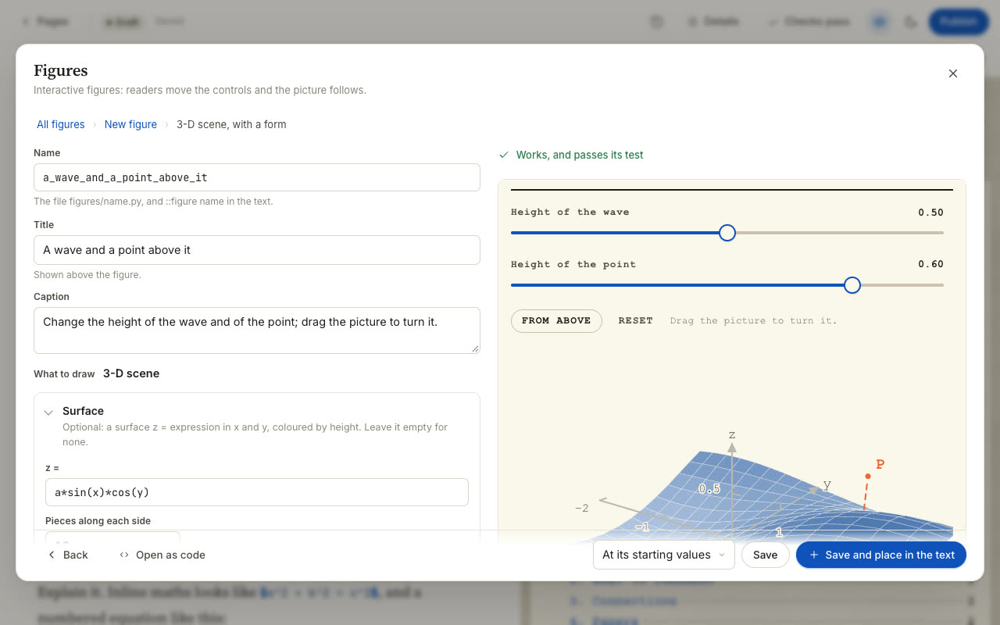

# 3-D figures

A figure can also be a small 3-D scene. The reader turns it by dragging the picture, and moves points by dragging
their handles. On this page you will make one with the form, start one from the four examples, and write one by
hand with `bazinga.scene3d`.

Everything else about figures (controls, presets, testing, placing them in a post) works as in
[Interactive figures](figures.md).

::clip figure-3d | Turning a surface by dragging it, then dragging the point P across it.

The example site's *Making Interactive Figures* page has a working one, `figures/tangent_plane.py`: drag P across
the surface, drag anywhere else to look from another side, and bend the surface with the sliders.

## How it works

You describe the scene in ordinary x, y, z coordinates, with z pointing up. `bazinga/scene3d.py` works out where
everything lands on the screen, draws what is nearer on top of what is behind, and keeps the labels clear of each
other. It uses the standard library only, so the same file runs when the site is built and in the reader's
browser, like every other figure.

## Make one with the form

1. In the Editor, press **Figure…**, then **New figure**, then **Fill in a form**.
2. Choose **3-D scene**.
3. Fill in what you need:
    - **Surface:** optional, `z =` an expression in `x` and `y`, coloured by height, and **Pieces along each side**
      (4 to 24).
    - **Points:** x, y and z (up) as expressions, a label and a colour. **Repeat n times** draws several, with
      `k = 0, 1, 2 …` inside the expressions.
    - **Segments and arrows:** from a point to a point, with **Arrow at the end**, a label, a colour and a line.
    - **Boxes:** a box between two opposite corners, with see-through sides.
    - **View:** the box the scene fills, and where the reader looks from at first (**Turned by** degrees around the
      up axis, **Looking down by** degrees). **Axes** and **Numbers on the axes**.
    - **Controls**, **Values**, **Readouts** and **Presets**, as in every form.
4. Press **Save and place in the text**.

**What you should see:** the preview turns when you drag it, and the test above it says
**Works, and passes its test**.

{ .shot }

The form's own example is also a file you can copy: `python -m bazinga figure new my_scene --from builder:scene3d`.

## Start from an example

Four examples are 3-D:

| Starter | Title | What it shows |
|---|---|---|
| `scene_basic` | A cube you can turn | a cube with numbered axes; drag to turn it, a slider grows it |
| `surface_plot` | A wave on a sheet | the surface z = a · sin(k·x) · cos(k·y), with sliders |
| `vectors_planes` | The cross product | two vectors whose tips you drag, their cross product and the plane they span |
| `camera_rig` | A point becomes a pixel | a pinhole camera, the picture it takes, and panels to move and turn it |

```bash
python -m bazinga figure new my_vectors --from vectors_planes
python -m bazinga figure test my_vectors
```

```text
Created figures/my_vectors.py. Use it in a post with ::figure my_vectors
ok   my_vectors  (54 ms for all states)
```

All four pass `figure test` as they come. Each file explains itself in comments, and all four work on the example
site's templates page (`/reads/templates/`).

## Write one by hand

A complete 3-D figure:

```python
from bazinga.scene3d import Scene

TITLE = "A saddle"
CAPTION = "Drag the picture to look from another side."
CONTROLS = [{"name": "view", "kind": "orbit", "value": [35, 25]}]   # drag the picture to turn it


def compute(view=(35, 25), _narrow=0):
    sc = Scene()                                          # z is up
    sc.axes3d(lo=(-1, -1, -1), hi=(1, 1, 1))              # three axes with numbered ticks
    sc.surface(lambda x, y: x * x - y * y, x=(-1, 1), y=(-1, 1), z_range=(-1, 1))
    sc.vector((0, 0, 0), (0.8, 0.3, 0.6), label="v")      # an arrow
    return sc.render(view=view, narrow=_narrow, dist=5)
```

`Scene()` has z up. `Scene(up="-y")` uses the camera convention (y down, z forward), and `Scene(up="y")` has y up.

### What a scene can hold

| Call | Draws |
|---|---|
| `point(p, label)`, `line(a, b)`, `vector(origin, v, label)` | points, segments and arrows |
| `path(points)`, `poly(corners)` | a path, and a flat polygon |
| `box(lo, hi, faces=True)`, `plane(point, normal)` | boxes and pieces of planes |
| `surface(f, x=(lo, hi), y=(lo, hi), n=18)` | the surface z = f(x, y), coloured by height |
| `curve(f, t0, t1)` | a curve through space, f(t) = (x, y, z) |
| `axes3d(lo, hi, ticks=4)`, `axes(length)`, `grid(size, n)` | axes with numbers, plain axes, and a floor |
| `text`, `callout`, `dim`, `arc` | labels, notes with a leader line, measurements and angles |
| `camera(R, C, K)`, `ray(X, cam)`, `image_view(K, R, C, points=…)` | a pinhole camera, its rays and the picture it takes |

Styles are the same names as in every figure (`main`, `second`, `muted`, `ink`, `dashed`, `thick` …). Polygons also
take `plane` (see-through, the default), `solid`, `outline` and `paper`.

`render(view=…, readouts=…, note=…, handles=…, state=…, narrow=_narrow, dist=…)` returns the figure. Pass
`_narrow` on, so phones get their own layout.

### Controls for a scene

Besides `slider`, `toggle` and `steps`, a 3-D figure may use:

| Kind | What it is |
|---|---|
| `orbit` | the direction you look from, `[turn, height]` in degrees. It has no slider: the reader drags the picture |
| `pad` | a point (one number or a short list) that the reader drags in the picture; its value shows under the figure |
| `hidden` | the same as `pad`, not shown |

Controls that share the same `"group"` text fold into one panel under that heading, which keeps a long list tidy.

### Points the reader drags

1. Add a `pad` control that holds the point, for example
   `{"name": "p", "kind": "pad", "label": "P (x, y)", "min": [-1.8, -1.8], "max": [1.8, 1.8], "value": [0.9, -0.6]}`.
2. Give `compute()` a `_drag=None` argument.
3. Turn the drag into new values with `apply_drag(_drag, rules, values, **layout(_narrow, …))`. A rule
   `("plane", point, normal, (0, 1))` keeps the dragged point in a flat plane and stores its x and y.
4. Give `render()` a handle named after the control: `handles=[{"name": "p", "at": P, "hint": "drag the point P"}]`.
5. Hand the new value back with `render(state={"p": [...]})` when `_drag` is set, so the controls follow.

`vectors_planes` does exactly this in a dozen lines, and `figures/tangent_plane.py` on the example site is a longer
example.


### More of the kit {#more-of-the-kit}

The rest of `bazinga.scene3d`, for bigger figures. Each name below was used in a test figure that passed
`figure test`.

| Name | What it does |
|---|---|
| `plot_inset(name, xs, series, title=…)` | a small line plot beside the scene: `series = [(label, ys, style)]`; pass it in `render(insets=[…])` |
| `sc.image_view(K, R, C, points=…)`, `sc.as_inset(rendered, name, title)` | a camera's own picture, or a whole second scene, shrunk into an inset |
| `sc.panel(view, …, columns=2)` | only the scene panel, to put beside ordinary panels: `{"panels": [sc.panel(…), {…}]}` |
| `sc.on_image(cam, X)` | where a world point meets a camera's drawn image plane |
| `Flat(scale, origin)` | the same calls (`point`, `line`, `path`, `poly`, `text`, `callout`, `dim`) on a plain 2-D picture, with `render(note=…)` |
| `layout(narrow, dist, target, …)` | the scene's framing; give the same values to `render()` and `apply_drag()` so a drag lands where the picture was drawn |
| `viewer(az, el, dist)`, `screen_of(view, p)` | the orbiting camera that draws the scene, and where a world point lands in the picture |
| `rig_controls(cams=(1,))`, `rig_from(values)` | a panel of controls for moving cameras and changing f and the principal point, and the K, R, C they give: `rig_from(values)[1]` is `{"K", "R", "C"}` of camera 1 |
| `camera_handles(rig)`, `camera_drag_rules()`, `camera_drag_controls(values)` | handles to drag the camera centres, their `apply_drag` rules, and the hidden controls they drive |
| `declutter(items, width, height)`, `label_report(spec)` | how labels are kept off each other (`render` does this for you), and a check for tests that lists overlapping labels |
| `fmt`, `vec`, `sig`, `nice_ticks` | number formatting for readouts and ticks |

The example site's `camera_rig` starter uses the camera helpers together; copy it with
`figure new my_rig --from camera_rig` to see them working.

## Testing

`figure test` checks a 3-D figure like any other (starting values, every preset, 20 random settings, under
30 milliseconds each, no `nan`), and also drags every handle a little, wide and on a phone.

## Limits

- A scene is drawn as flat shapes, nearest on top. Keep it to a few hundred items; the test fails a figure that is
  too slow.
- A surface is a grid of `n × n` pieces. More pieces look smoother and cost more; `surface_plot` takes about
  ten times longer to test than the simple examples.
- The reader turns the view and drags handles; there is no zoom.

## What's next

Next, diagrams that are drawn once and do not move: [Diagrams from code](diagrams.md).

- Place a 3-D figure in a post: [Writing, step 5](writing/figures-in-posts.md).
- Everything else about figures: [Interactive figures](figures.md).
