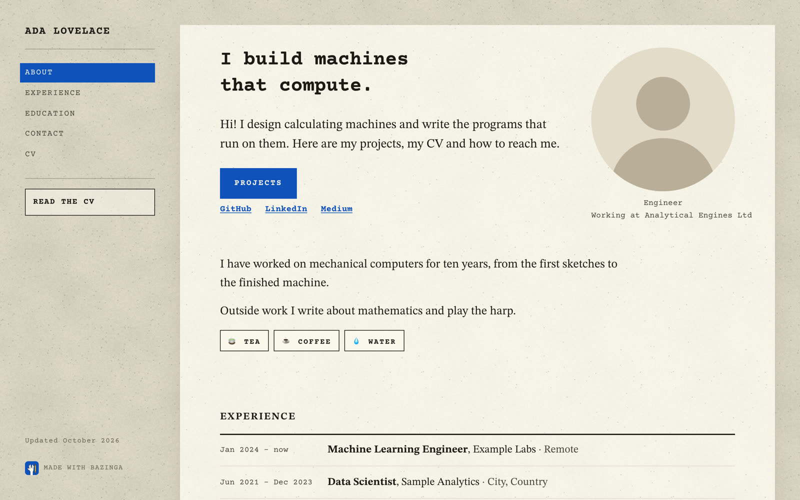
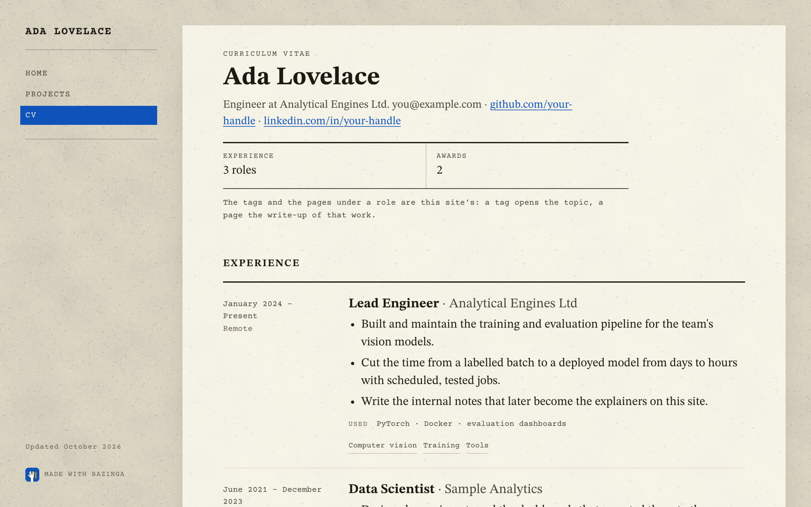
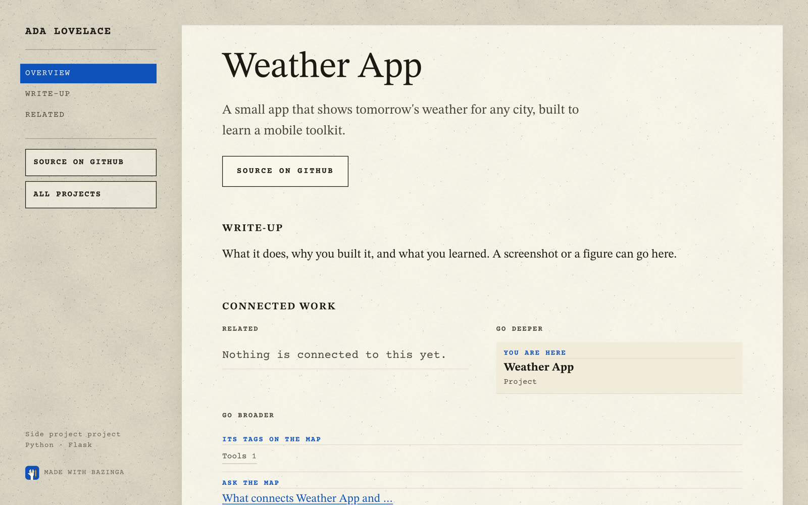

# Your portfolio: home page, CV and projects

Bazinga is not only for blogging. It is a complete personal website: a home page with your photo, who you are, your
experience, education and a contact section, a CV page, and a page for each of your projects. Use it as a portfolio
with no blog at all, as a blog, or as both. In this guide you will put your own name, photo, words, record and
projects on the site.

These are the places that hold everything personal:

| What visitors see | Where you change it |
|---|---|
| Your name, links, email, tab icon and share picture | `site.yml` → `site:` |
| Photo, role, headline, About, Experience, Education, Contact | `site.yml` → `home:` |
| The CV page at `/cv/` (and an optional PDF) | `content/cv.yml`, and `site.yml` → `cv:` |
| Your projects | one file each in `content/projects/` |
| The rail (the menu down the left side) | `site.yml` → `nav:` |



Keep `python -m bazinga serve` running while you edit. The page reloads every time you save.

::clip portfolio-tour | A portfolio: the home page, a role in Experience, Contact, the CV and a project.

## Your name and links

Open `site.yml` and start with the `site:` section at the top.

```yaml
site:
  name: "Your Name"
  author: "Your Name"
  tagline: "Notes on the things I build and learn"
  description: "Reads, paper explainers and projects in machine learning, with interactive figures and a map of how every page connects."
  origin: "https://example.com"
  language: en
  avatar: ""
  links:
    github: "https://github.com/your-handle"
    linkedin: "https://www.linkedin.com/in/your-handle/"
    medium: "https://medium.com/@your-handle"
    scholar: ""
    x: ""
    email: "you@example.com"
```

| Field | Where it shows |
|---|---|
| `name` | the brand at the top of the rail, the browser tab, search results |
| `author` | the header block of every page, the feed, and search engines |
| `tagline` | the feed's subtitle; also the home page's search description when `description` is empty |
| `description` | what search engines show for the home page (155 characters at most) |
| `origin` | the address the site will live at, with no `/` at the end; used for canonical links, the sitemap and the feed |
| `avatar` | optional picture, such as `static/avatar.png`: the browser-tab icon and the share image. Without it, the tab shows the Bazinga mark |
| `links` | buttons on the home page. GitHub, X, LinkedIn and Scholar always come first, in that order; other names follow in the order you write them. Leave a value empty to hide it |

The link names `github`, `linkedin`, `medium`, `scholar`, `x`, `twitter`, `mastodon`, `bluesky`, `youtube`,
`website`, `orcid` and `substack` get a proper label (GitHub, LinkedIn, ...). Any other name is shown with each
word capitalised and `_` as a space (`my_blog` → My Blog). `email` is special: it is never shown as a plain link; it feeds the Contact section's
email button instead.

**What you should see:** after saving, the rail shows your name and the home page shows your links.

## The home page, section by section

The home page is built from the `home:` section of `site.yml`. Every field is optional. A section whose fields are
missing is left out.

### The top

```yaml
home:
  title: "Machine Learning Notes"
  photo: /static/images/photo.svg
  role: "Machine Learning Engineer"
  employer: "Example Labs"
  working_at: "Working at Example Labs"
  tagline: "Notes on how learning machines work, one figure at a time."
  statement: ""
  lead: >-
    Hi! I build machine learning systems and write down how they work.
```

| Field | What it does |
|---|---|
| `title` | the home page's `<title>` (your `site.name` is added after it while the whole stays within 65 characters, so leave your name out) and its link-preview title (default: `site.name`) |
| `photo` | a square picture, shown round at 230 px; under it go `role` and `working_at` |
| `role` | first line under the photo; the CV page also says "role at employer" |
| `employer` | used only by the CV page's first line |
| `working_at` | second line under the photo |
| `tagline` | the big line at the top of the page (default: `site.name`) |
| `statement` | an optional bold line under the tagline |
| `lead` | the opening paragraph |
| `intro` | optional extra paragraph, written in Markdown (links, emphasis) |

Under the lead you always get one button per kind of page (Reads, Papers, Projects, ...), then your links.

**Your photo:** put a square picture (about 600 × 600 pixels) in `static/images/` and point `photo:` at it, for
example `/static/images/me.jpg`. Note the leading `/`. To use the same picture as the browser-tab icon and the
picture in link previews, also set `site: avatar: static/images/me.jpg`. Note: `avatar` has no leading `/`, unlike `photo`.

**What you should see:** your photo, round, with your role under it.

### About, and the "pick one" buttons

```yaml
  about:
    - >-
      Replace these paragraphs with a few lines about you.
    - >-
      When an idea finally clicks, I write it down: the concepts live under <a href="/reads/">Reads</a>.
  starters_label: "Pick one"
  starters:
    - {name: Tea,    mark: "🍵", say: "Tea. A person of patience."}
    - {name: Coffee, mark: "☕", say: "Coffee. We will get along just fine."}
```

`about` is a list of paragraphs. They are printed as written, so they may carry `<b>`, `<i>` and `<a>`.
`starters` are small buttons under About; clicking one shows its `say` line. Delete `starters_label` and `starters`
to hide them.

### Explore

```yaml
  map_text: "Everything I have written or built is on one map, each item below what it builds on."
```

This section points at the map and appears while `features.explore` is on. `map_text` replaces the default sentence.

### Experience and education

```yaml
  experience:
    - period: Jan 2024 – now
      role: Machine Learning Engineer
      org: Example Labs
      place: Remote
      points:
        - Built and maintain the training and evaluation pipeline for the team's vision models.
      pages: [project:bazinga]
  education:
    - {degree: "MSc, Computer Science", school: "Example University"}
  courses: "Machine Learning, Computer Vision, Optimization, Probability and Statistics."
```

Each role is a line that opens to show its `points`. `pages` takes ids of pages on your site about that work, and
they are linked under the points. An id that does not exist stops the build with a hint, so typos never reach the
site. Education shows the degree and the school only. `courses` is folded away under "Courses and electives".

**What you should see:** each Experience line opens when you click it.

### Contact

```yaml
  contact:
    lead: >-
      Have a project where machine learning should help but does not yet? Write a short note.
    areas:
      - {mark: "👁️", name: Computer vision, what: "Detection, tracking and recognition in images and video."}
    stack:
      - {area: Machine learning, tools: [PyTorch, NumPy, scikit-learn]}
    close: "Send me a short note on what you want to build."
    email_button: "Email me about a project"
    links_text: "Code, career record, and where the articles were first published."
    elsewhere:
      - {label: "Elsewhere on this site", url: /elsewhere/, text: "Articles that live on other sites."}
```

| Field | What it shows |
|---|---|
| `lead` | the opening line (inline HTML allowed) |
| `areas` | "What I work on": a mark, a name and one line each |
| `stack` | "Tech stack": a group name and its tools |
| `close` | the line next to the email button |
| `email_button` | the button's text; the button appears when `site.links.email` is set |
| `links_text` | the line under your links in "Elsewhere" |
| `elsewhere` | more entries for "Elsewhere": a label, an address and a line |

When `site.links.linkedin` is set, a "Message on LinkedIn" button appears next to the email button.

### The rail on the home page

On the home page the rail lists the page's own sections (About, Explore, Experience, Education, Contact, each only if
it is shown), followed by the Series, Ask and CV items from your `nav:`.

## The CV page

The CV lives in `content/cv.yml`. The page at `/cv/` lays it out; you only fill in the record. Its heading is your
`site.author`. If the file does not exist, there is no CV page.

```yaml
contact:
  email: you@example.com
  links:
    - {label: github.com/your-handle, url: "https://github.com/your-handle"}

experience:
- org: Example Labs
  role: Machine Learning Engineer
  place: Remote
  period: January 2024 – Present
  points:
  - Built and maintain the training and evaluation pipeline for the team's vision models.
  tags: [computer-vision, training, tools]
  pages: [project:bazinga]
  used: [PyTorch, Docker, evaluation dashboards]

education:
- degree: MSc, Computer Science
  school: Example University
  place: City, Country
  period: 2019 – 2021

patents: []

achievements:
- what: Graduate research scholarship
  when: 2019–21
  detail: For a study on efficient vision models

skills:
- area: Languages
  items: Python, C++, SQL, JavaScript

open_source:
- text: A template for technical writing with real equations, interactive figures and a map of the site
  page: project:bazinga
```

| Section | Each entry holds |
|---|---|
| `contact` | `email`, and `links` as `{label, url}` |
| `experience` | `org`, `role`, `place`, `period`, `points`; optional `tags`, `pages`, `used`, `link` |
| `education` | `degree`, `school`, `place`, `period` |
| `patents` | `number`, `title`, `note`, `url` (an empty list hides the section) |
| `achievements` | `what`, `when`, `detail` |
| `skills` | `area`, and `items` as one comma-separated line |
| `open_source` | `text`, and optionally `page`: the id of the page about it |

Per role:

- `tags` are topic slugs from `content/topics.yml`; they link to the topic pages.
- `pages` are ids of pages on your site about that work.
- `used` lists the tools and methods the role's lines name.
- `link` is one more page or address for the role, as `{label, url}`.

The build checks the `tags` and `pages`. An unknown one stops `python -m bazinga build` with a message such as
`cv.yml: unknown topic 'vison' under Example Labs` and a hint (`serve` shows it as a note and leaves the item out).
Project pages with a `github:` header field that are not already listed under `open_source` are listed by
themselves, under **More on GitHub** in the open-source section.

The CV's first line reads "role at employer" from `home.role` and `home.employer` in `site.yml`.

### A PDF copy

To offer a download, put the file under `static/` and name it in `site.yml`:

```yaml
cv:
  pdf: /static/cv.pdf
```

A full address works too. With a PDF set, the button in the home page's rail says **Download CV** and opens the
file. Without it, that button says **Read the CV** and opens `/cv/`. The CV page itself shows no download button, so
link the PDF from your About text as well if you want it there.

**What you should see:** open `http://127.0.0.1:8000/cv/`. Your roles, education and skills are laid out in the
same order as the file.



## Your projects

Each project is one Markdown file in `content/projects/`. Delete the example and add your own:

```markdown
---
title: "Weather App"
date: 2026-05-01
summary: "A small app that shows tomorrow's weather for any city."
topics: [tools]
type: Personal              # the page says "Personal project"; e.g. Open-source, Client, Research
stack: "Python · Flask"
github: "https://github.com/your-handle/weather-app"
---

What it does, why you built it and what you learned.
```

To add a screenshot, put it in `static/uploads/` and write `` on its
own line. A figure readers can move goes on its own line too, as `::figure name`
([Figures in a post](writing/figures-in-posts.md)). A project page is written like any other page, so the
[Writing](writing/index.md) steps (equations, citations, links, checking, publishing) all work here.

**What you should see:** the project at <http://127.0.0.1:8000/projects/> and its page, with **Source on GitHub** in
the rail.

### Project pages {#project-pages}

A project page takes a few more optional header fields. This is what each one shows:

```yaml
type: Research                 # "Research project" at the foot of the rail, and the Type column of /projects/
stack: "Python · NumPy"        # under the type, at the foot of the rail
tagline: "One thing, done well."              # a large line under the title
lead: "A longer opening line for the page."   # the opening paragraph (without it, the summary is used)
from: "Example Labs"           # adds a facts box: Type, From, Headline result (the summary) and Tags
github: "https://github.com/your-handle/demo-tool"   # "Source on GitHub" buttons, and a GitHub link in lists and the CV
usage: |                       # a Usage section, shown as a code block
  pip install demo-tool
limitations:                   # a Limitations section, as a list
  - Only works on small inputs.
credit: "Built with help from a friend."      # a small note under Connected work
order: 1                       # sorts the /projects/ list (smaller first; default 99, then by title)
```

What you should see: the page opens with the title, the tagline and the lead, then **Usage**, your write-up,
**Connected work** and **Limitations**. The example `content/projects/bazinga.md` uses `type`, `stack` and `short`.
(A `launch:` field is read into the site's data too, but the default theme does not show it.)



## A portfolio without the blog

If you only want a portfolio, turn the blog parts off. Their pages and buttons go away. Two links stay behind for
now: the "Ask the map" line at the end of each project page, and the link to the map on `/topics/`.

1. **Delete the example posts:** the folders `content/reads/`, `content/papers/` and `content/elsewhere/`, and the
   example project:

    ```bash
    rm -r content/reads content/papers content/elsewhere content/projects/bazinga.md
    ```

2. **Keep only the kinds you use** in `site.yml`:

    ```yaml
    kinds:
      projects:
        label: Projects
        singular: Project
        blurb: "Things I have built."
    ```

3. **Trim the menu:**

    ```yaml
    nav:
      - {label: Home, href: /}
      - {label: Projects, href: /projects/}
      - {label: CV, href: /cv/}
    ```

4. **Turn off what you don't need:**

    ```yaml
    features: {ask: false, explore: false, series: false, feed: false, llms_txt: true, credit: true}
    ```

5. **Remove the links to the blog:**
    - rewrite `home: about:` so it no longer points to Reads or Papers;
    - delete the "Elsewhere on this site" line under `home: contact: elsewhere:`;
    - delete `pages:` entries in `site.yml` and `pages:` / `page:` entries in `content/cv.yml` (including
      `open_source`) that name pages you deleted;
    - in `content/cv.yml`, keep only `tags:` that one of your projects also uses, or delete the `tags:` lines (each
      tag links to its topic page, and a topic that no page uses has no page);
    - rewrite `home: tagline:`, `lead:` and `title:`, `site: description:` and `home: contact: links_text:` so they
      describe your work, not posts.
6. Run `python -m bazinga build`. If a page id still names a deleted page, the build stops at the first one and
   says where, for example `site.yml: error: home.experience: unknown page 'project:bazinga'`. Fix it and build
   again until it passes. Plain `<a href>` links in your text are not checked, so look for `/reads/` and `/papers/`
   yourself.

**What you should see:** with one project, `Built 1 pages (7 HTML files) into _site/`, and a site with Home,
Projects and CV only. The pictures and the clip on this page come from such a site.

Before you deploy it, read [The tests check the example pages](deploying.md#step-2-check-everything): the tests
that come with Bazinga expect the example pages you just deleted.

Want a blog later? Add the `reads` kind back and write your first post: see [Writing](writing/index.md).

## What's next

Next, update Bazinga when a new version comes out: [Updating Bazinga](updating.md). Or:

- Change the colours and fonts: [Theme and customising](theme.md).
- Write about your projects, or start a blog: [Writing](writing/index.md).
- Put it online at your own address: set `site.origin`, then follow [Deploying](deploying.md).
- Every key in one table: [Configuration reference](reference/configuration.md).
