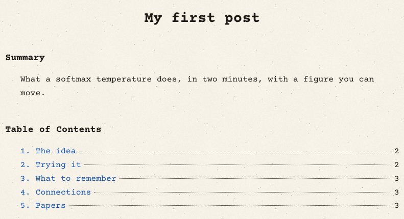
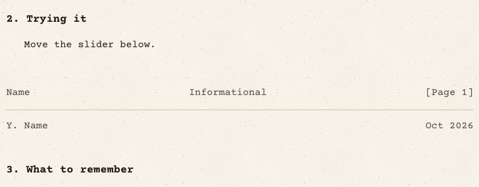

# 2. Sections and contents

On this page you learn exactly how a post's headings become its numbered sections and its table of contents, how to
split a long post into "pages", and what Bazinga adds around your text by itself.

Reads and papers use a memo layout: a header block, the title, a **Summary**, a **Table of Contents** with page
numbers, your sections, then **Connections** and **Papers**. You only write the sections. Everything else is made
for you.

## Step 1: write your sections with `##`

Every `## ` heading (level 2) starts a section and becomes one line of the table of contents. Here is a complete post
body. It has three sections, a smaller heading, a citation, and one page break:

```markdown
A short opening paragraph says what the page answers.

## The idea

Dividing scores by a temperature before the softmax changes how sharp it is [@Hinton15].

### A detail

A level-3 heading gets an anchor, but it is not in the contents.

## Trying it

Move the slider below.

::pagebreak

## What to remember

One short paragraph.
```

**What you should see:** the top of the page, built from that file:

{ .shot }

In the Editor you can watch it happen: each `##` heading joins the contents as you type it.

::clip editor-sections | Typing ## headings in the Editor: each one becomes a numbered line of the contents in the preview.

Here is what happened, line by line:

- **Summary** is the `summary:` field from the header, word for word.
- **Your sections are numbered** 1, 2, 3 in the order you wrote them. The numbers are added to the headings in the
  page too, so the heading reads "1. The idea".
- **`###` headings are not listed.** Only `##` headings make the contents. Smaller headings still get an anchor you
  can link to.
- **Connections** is always added as the next number. It shows what the page builds on, what links to it, related
  pages, and where to go deeper or broader. You do not write it.
- **Papers** is added after it when the page cites at least one paper. It is the numbered reference list. See
  [Citations](citations.md).
- **The numbers on the right are page numbers.** The opening block (title, summary, contents) is page 1, so your
  first section starts on page 2. Each `::pagebreak` starts a new page.

The text before your first `##` heading is the opening paragraph. It is not a section and has no line in the
contents.

The menu at the side of the page (the rail) lists the same entries, starting with Summary, so readers can jump to a
section from anywhere on the page.

## Step 2: split a long post with `::pagebreak`

Put `::pagebreak` on a line of its own between two sections. The page draws a thin footer and a new page header
(your first initial and surname, and the month and year), like a printed memo; the footer shows your surname and
the page number:

{ .shot }

Sections after the break get the next page number in the contents. In the example above, "What to remember" moved to
page 3, and so did Connections and Papers, which always sit on the last page.

Page breaks change nothing else: the post is still one web page and one address.

## Step 3: number the headings yourself, if you prefer

If **every** `##` heading already starts with a number, Bazinga leaves them alone:

```markdown
## 1. The idea {#idea}

## 2. Trying it

## 3. What to remember
```

**What you should see:** the same contents, with your own numbers:

```text
1. The idea ............ 2
2. Trying it ........... 2
3. What to remember .... 3
4. Connections ......... 3
5. Papers .............. 3
```

If only some headings start with a number, Bazinga numbers all of them, so you would get "1. 1. The idea". Number
all or none.

## How the anchors are made

Every heading gets an id, so you can link to it with `#id` and readers get a `#` link when they hover the heading.

- The id is the heading's words in lowercase, joined by dashes: `## What to remember` becomes `#what-to-remember`.
  Your own numbers are part of the words: `## 2. Trying it` becomes `#2-trying-it`.
- To choose the id yourself, add `{#name}` at the end of the heading: `## 1. The idea {#idea}` becomes `#idea`.
  Do this for sections other pages link to, so the links keep working when you reword the heading.
- When two headings have the same words, the second gets `-2`, the third `-3`, and so on.
- The ids `references`, `connections`, `top` and `footnotes` are kept for the page itself, so a heading with those
  words gets `-2` added.

!!! warning "Headings called Summary or Papers"
    The page already has a "Summary" (`#summary`) and, when you cite papers, a "Papers" (`#papers`) section. Avoid
    `##` headings with exactly those words; two sections would share one address.

!!! note "Your own reference list"
    If one of your `##` headings starts with "Reference" (for example "## References"), Bazinga assumes you wrote
    your own list and does not add the Papers section.

## Projects are different

Project pages (`content/projects/`) use a project layout. Their headings are not numbered and have no page numbers,
and the side menu lists **Overview**, **Usage** (when the header has `usage:`), your sections (or **Write-up** when
there are none), **Related**, and **Limitations** (when the header has `limitations:`). The other
memo parts (Summary, Table of Contents, page breaks) belong to reads and papers.

## What's next

Your post has sections. Next, add some maths to them: [3. Equations](equations.md).
